# 教师班主任工作台（本地服务版）· 操作说明

> 图文操作手册 · 配合截图逐步讲解 · 演示数据均为虚构
> 本版本基于 @赛博老爸 开源版改造：数据存本机、AI 不再受浏览器跨域限制

---

## 一、启动与访问

1. 双击 **`start.bat`**（开发目录）或绿色版里的 **`启动工作台.bat`**
2. 黑色控制台窗口显示「已启动 → http://127.0.0.1:8788/」，浏览器自动打开工作台
3. **使用期间保持黑窗口开着**；用完关掉窗口即退出（数据不受影响）

> 启动日志里会显示实际地址：若 8788 被占用会自动换 8789、8790……以窗口显示为准。

---

## 二、首次使用（3 步开始）

第一次打开会出现欢迎页，三步完成初始化：

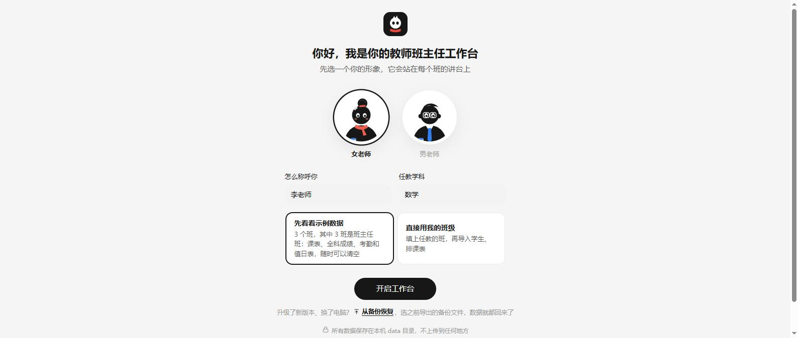

1. **选形象**：点「女老师」或「男老师」，它会站在每个班的讲台上
2. **填称呼和学科**：如「李老师」「数学」
3. **选开始方式**：
   - **先看看示例数据**：载入 3 个虚构的班（3 班是班主任班），随便点随便试
   - **直接用我的班级**：填任教班级、勾选班主任班、选学段和课桌摆法

最后点「**开启工作台**」进入教室。

---

## 三、教室主界面（每天主要在这里）

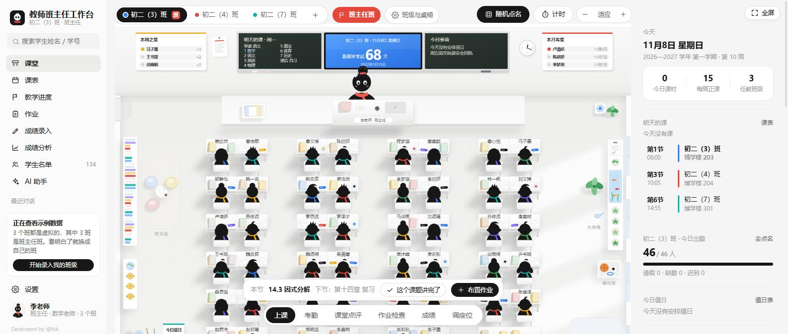

- **顶部班级栏**：点班级一键切换；「班主任」按钮决定哪个班是班主任班
- **左边黑板**：今日课程自动按星期刷新，上完的打勾、正在上的高亮
- **中间智慧屏**：上课时显示倒计时和本节课题；平时显示考试倒计时
- **鼠标移到学生身上**：学生回头 + 弹出信息卡，点「查看档案」看完整档案
- **右侧栏**：今日课程、出勤、值日、近期生日、作业、进度、最近考试

### 底部六个模式（点一下切换）

| 模式 | 用法 | 截图 |
|---|---|---|
| **上课** | 平时浏览；讲完点「这个课题讲完了」进度自动前进；可「布置作业」 | 见上图 |
| **考勤** | 点学生循环切换：出勤→请假→缺勤→迟到；可补录、导出本月 | 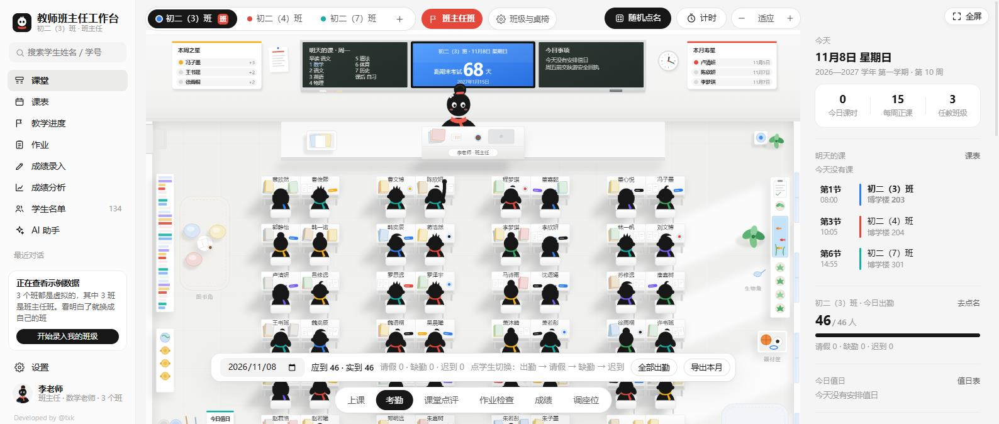 |
| **课堂点评** | 点学生选理由加减分，头顶飘分；支持多选（按组/排/全班）、一键撤销 | 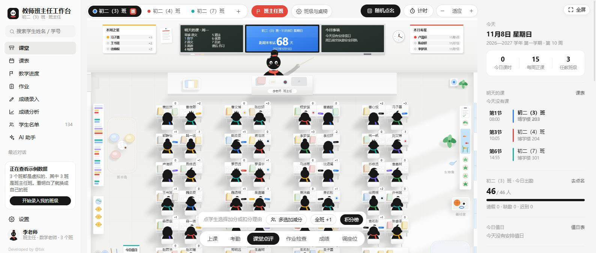 |
| **作业检查** | 选一次作业，逐个标：已交/优秀/需订正/未交 | 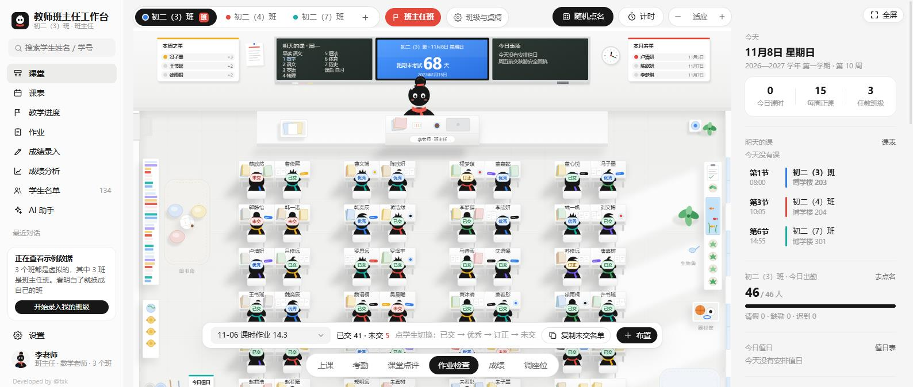 |
| **成绩** | 桌面颜色越深排名越靠前，进退步 5 名标 ↑↓ | 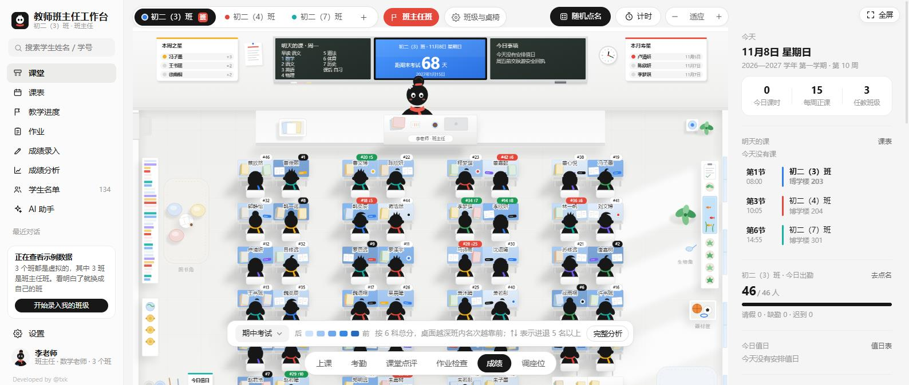 |
| **调座位** | 拖动换座；「随机打乱」「优带弱同桌」「男女同桌」一键排；可撤销、打印 | 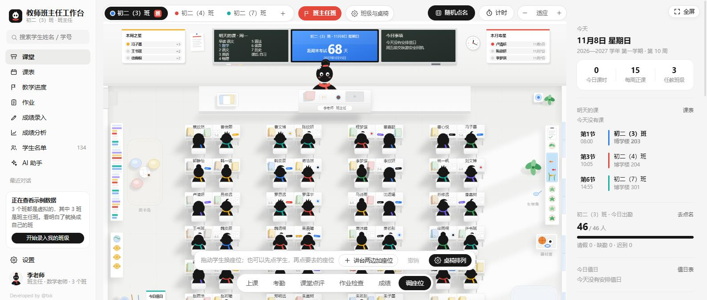 |

### 两个课堂小工具

- **随机点名**：右上角「随机点名」，光标在全班跳动，停中的同学举手，可一键「回答得好 +1」
  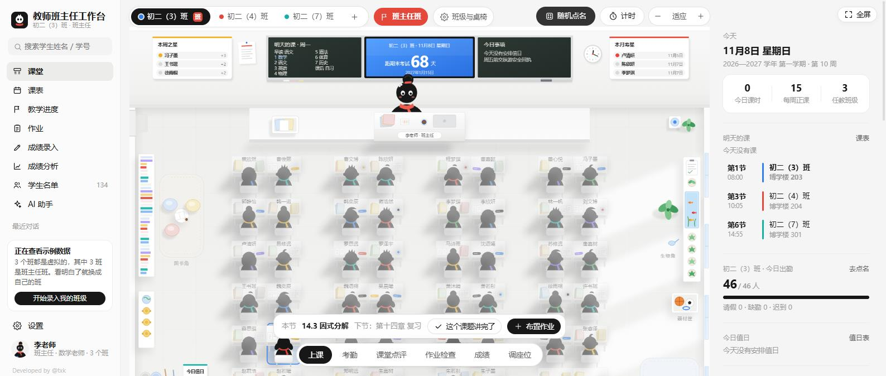
- **课堂计时**：右上角「计时」，选 1~15 分钟或自定义，教室显示倒计时

---

## 四、功能页（左侧栏进入）

### 1. 我的课表

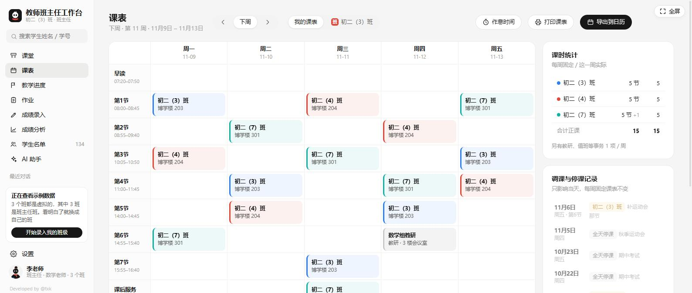

点任意格子排课（正课/早读/辅导/晚自习等）；「只改这一次」做临时调课，两节课可对调；整日停课、课时统计、打印、**导出 .ics 到手机日历**（每节课前 10 分钟提醒）。

### 2. 教学进度

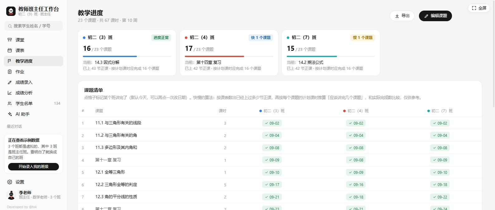

把学期课题按顺序贴进来，每个班讲到哪儿一目了然；按已上课时自动推算「正常 / 偏快 / 偏慢」。教室上课模式的「这个课题讲完了」就是在这里推进度。

### 3. 作业管理

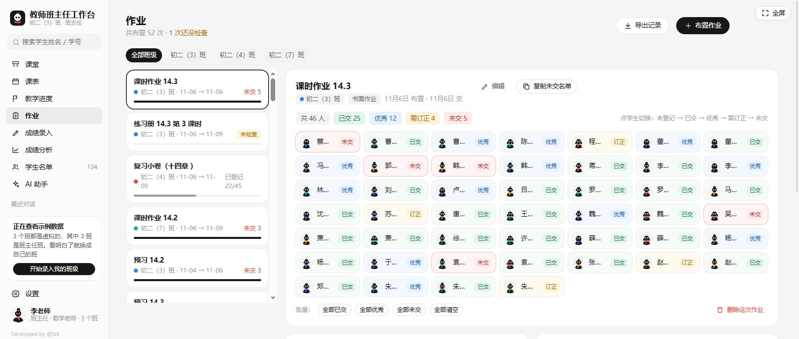

布置作业（7 种类型 + 截止日期）、逐个登记、自动列未交名单、统计完成率；教室的「作业检查」模式就是这个页的课堂快捷版。

### 4. 成绩录入

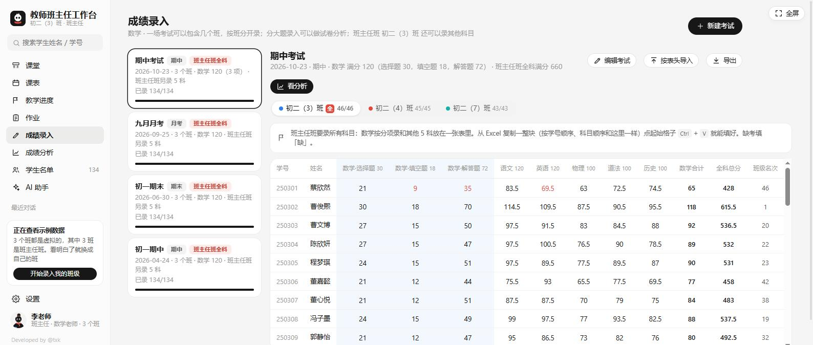

新建考试（月考/期中/期末等）→ 表格直接输分（回车跳下一人、方向键移动）；支持**从 Excel 整块粘贴**、按大题分项录入（选择/填空/解答分开）、缺考填「缺」、导出 CSV。

### 5. 成绩分析

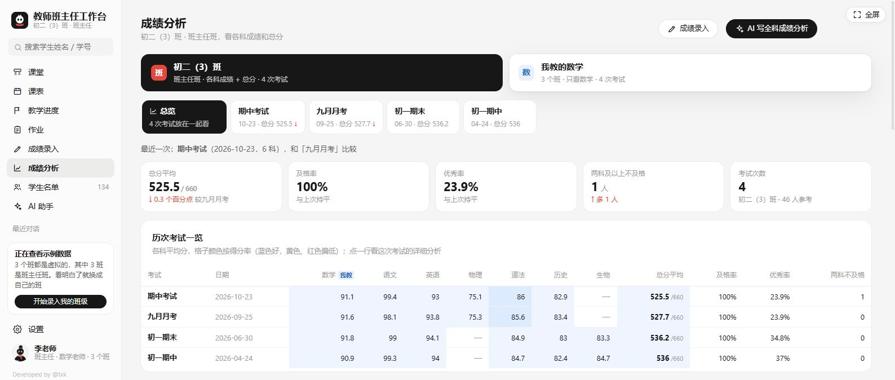

「总览」一次看全部：历次平均分/及格率/优秀率、趋势图、每位学生历次成绩、**需要关注名单**（连续退步、多次不及格、偏科）；点任一考试卡片看详细分析（平行班对比、分数段、临界生）。

### 6. 学生名单与档案

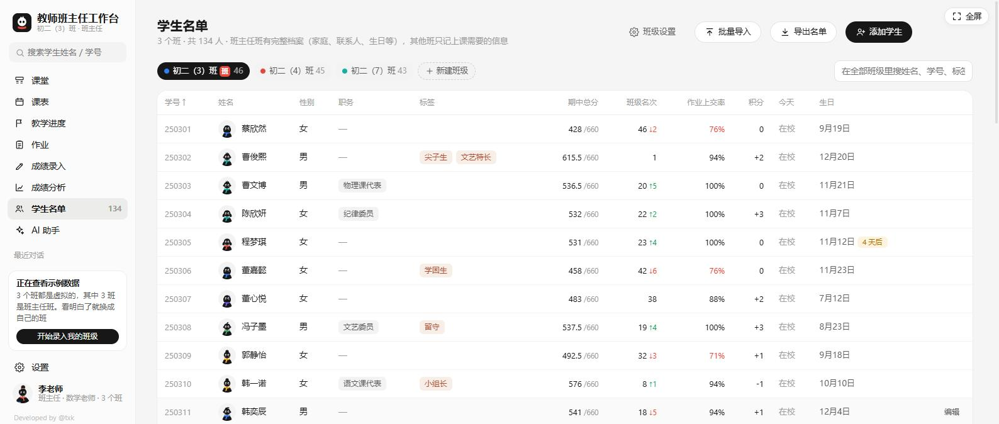

按班级查看全部学生；支持 Excel 批量导入名单、搜索、排序。点任意学生打开**完整档案**：生日、职务、家庭联系人、各科成绩趋势、作业、课堂表现、成长记录、评语。

### 7. AI 助手

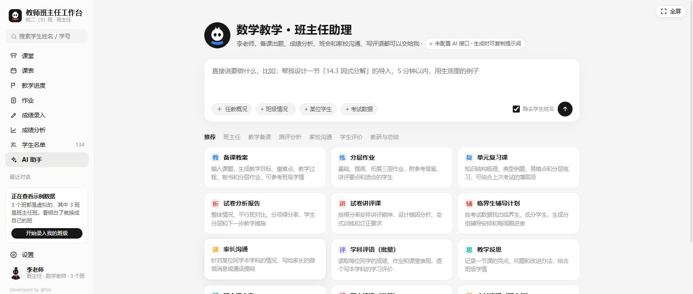

按分类选择模板（班会方案、期末评语、家长会发言稿、教案、试卷分析等 20+ 种），工作台自动把班级/学生数据整理成上下文，流式生成后可复制、导出 Word、继续追问。**批量期末评语**写完可一键存入每个学生档案。

> 没配 API Key 也能用：点「生成」会给你完整提示词，复制到豆包/DeepSeek 网页版即可。

---

## 五、设置

### 1. AI 接口（配置一次，全站可用）

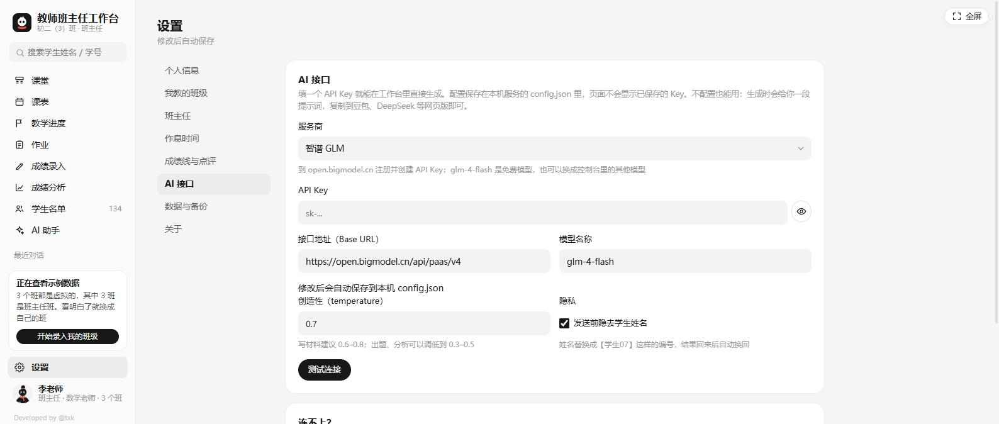

1. **选服务商**：智谱、DeepSeek、Kimi、通义等（自动带出接口地址和默认模型）
2. **填 API Key**：到服务商后台创建（如智谱：open.bigmodel.cn）
3. **填模型名称**：去服务商控制台复制最新模型名
4. 修改后**自动保存**，点「测试连接」验证

> 本版 AI 请求由本地服务转发，**不受浏览器跨域限制**，智谱等都可以直接用。Key 保存在本机 `server/config.json`，页面不会显示已保存的 Key。
> 「发送前隐去学生姓名」默认开启：姓名换成【学生07】编号发给 AI，回来自动还原。

### 2. 数据与备份

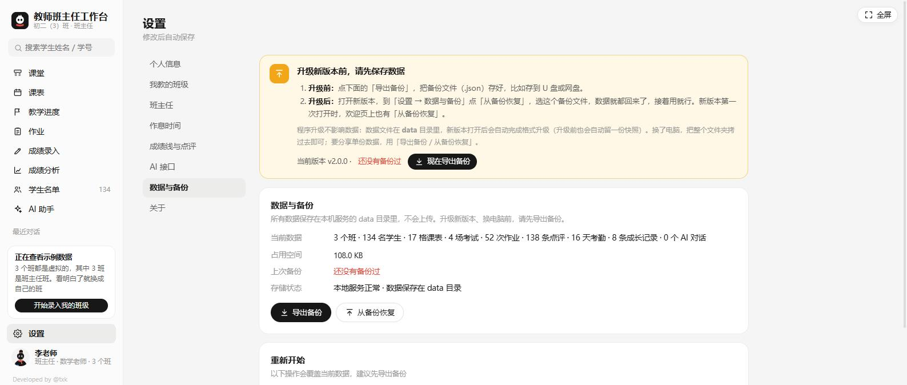

- **数据在哪**：本机 `data/state.json`，不上传任何服务器
- **自动保护**：每天自动备份（保留 30 份）+ 程序升级前自动留快照
- **手动备份**：点「导出备份」下载 .json 文件，建议每周一次、存 U 盘或网盘
- **恢复**：点「从备份恢复」选择备份文件，旧版本备份也能导入

### 3. 关于

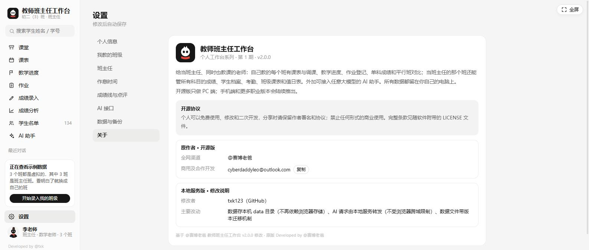

版本信息、开源协议（非商业许可）、原作者与修改者说明。

---

## 六、数据安全（本版核心改进）

| | 说明 |
|---|---|
| 存储位置 | 本机 `data/state.json`，清浏览器数据**不再丢资料** |
| 自动备份 | 每日一份 + 每 20 次修改留样 + 升级迁移前快照（`data/backups/`，保留 30 份） |
| 程序升级 | 新版本首次启动**自动迁移数据格式**，无需手动操作 |
| 多标签页 | 版本号保护，两个窗口同时改会提示刷新，不会互相覆盖 |
| 换电脑 | 把整个文件夹拷过去即可；或备份导出 → 新机恢复 |

---

## 七、常见问题

| 问题 | 处理 |
|---|---|
| 双击启动后浏览器没打开 | 看黑窗口里显示的实际地址（可能换了端口），手动访问即可 |
| 提示「本地服务未连接」 | 服务没开：双击 start.bat 后点页面上的「重新连接」 |
| AI 测试连接失败 | 按提示排查：①接口地址/模型名（去服务商后台复制）②余额 ③看具体错误信息 |
| 数据文件版本比程序新 | 数据在更新版程序里用过：请升级程序，数据不会被覆盖 |
| 想清空重新开始 | 设置 → 数据与备份 → 先导出备份 → 再清空 |

---

*操作说明完 · 演示数据均为虚构 · 原项目：[@赛博老爸](https://github.com/cyberdaddyleo/workstation-teacher) · 本地服务版：txk123*
